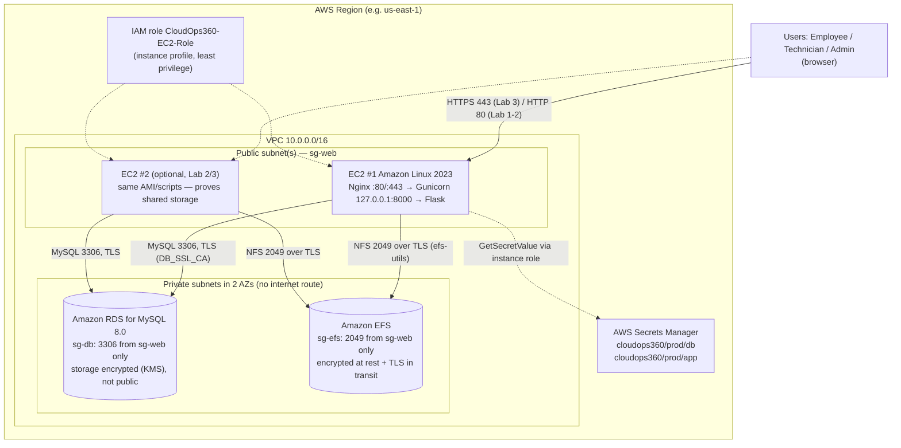

# CloudOps 360 — AWS Architecture

This is the architecture the scripts in `infrastructure/aws/` deploy. It is sized for an AWS lab
account (free-tier friendly: no NAT Gateway, no load balancer, single-AZ RDS). An optional
production extension is described at the end.

> **Status:** Lab 1 (single EC2 instance: Nginx + Gunicorn + MariaDB) **deployed and verified live** in the
> AWS Academy Sandbox. The RDS / EFS / IAM / Secrets Manager parts are designed and scripted, **not yet verified on AWS**.
> Run `infrastructure/aws/verify_deployment.sh` on your instance to collect evidence for each claim.

## 1. Lab architecture (Labs 1–3)

### What lives where

| Data | Location | Notes |
| :--- | :--- | :--- |
| Users, tickets, comments, status history, notifications, SLA policies, audit logs, login attempts, technician skills, settings, ratings | Amazon RDS for MySQL (`cloudops360` database) | Lab 1 uses MariaDB on the instance; schema is identical (Alembic migrations) |
| Attachment metadata (owner, ticket, size, MIME type, SHA-256, storage key) | RDS `attachments` table | |
| Attachment bytes | Amazon EFS `/mnt/efs/cloudops360-attachments/YYYY/MM/<uuid>.<ext>` | Lab 1: `/var/lib/cloudops360/uploads` |
| Flask `SECRET_KEY`, DB credentials | Secrets Manager (Lab 3); root-owned `0640` env file before that | Never in Git, never in responses or logs |

### Request path

`Browser → Nginx (TLS termination, static files, 13 MB body limit) → Gunicorn on 127.0.0.1:8000 →
Flask (ProxyFix trusts exactly one proxy) → RDS / EFS`. Gunicorn never listens on a public
interface; the database and NFS ports are reachable only from `sg-web`.

## 2. Security groups

| Security group | Inbound rule | Source | Purpose |
| :--- | :--- | :--- | :--- |
| `sg-web` | TCP 443 | `0.0.0.0/0` | HTTPS (Lab 3) |
| `sg-web` | TCP 80 | `0.0.0.0/0` | HTTP (Lab 1–2; redirect to HTTPS in Lab 3) |
| `sg-web` | TCP 22 | **your IP /32 only** (or no rule — use EC2 Instance Connect / SSM) | Administration |
| `sg-db` | TCP 3306 | `sg-web` (security-group reference) | MySQL from the app tier only |
| `sg-efs` | TCP 2049 | `sg-web` (security-group reference) | NFS from the app tier only |

Outbound: defaults (the instance needs HTTPS to reach Secrets Manager, package repositories and GitHub).
RDS is created with **Public access = No**; EFS mount targets exist only in private subnets.

## 3. Multi-instance shared storage

Both EC2 instances mount the **same** EFS file system at `/mnt/efs` and point `UPLOAD_FOLDER`
at `/mnt/efs/cloudops360-attachments`. Because metadata is in RDS and bytes are on EFS, a file
uploaded through instance #1 is downloadable through instance #2. The `/health` endpoint returns
the serving instance's hostname so you can show which instance answered, and
`flask storage-check` verifies every attachment row against the file and its SHA-256 on each
instance. The `efs` storage backend refuses uploads if `/mnt/efs` is not actually mounted, so an
instance with a failed mount can never silently write to its local disk.

Without a load balancer, demonstrate this by opening each instance's public address in turn.

## 4. Optional production extension (costs money — not part of the lab scripts)

* Application Load Balancer with an ACM certificate across two public subnets; EC2 instances move
  to private subnets behind it (requires a NAT Gateway or VPC endpoints for outbound access).
* Auto Scaling group using a launch template that runs `ec2_bootstrap.sh` and `efs_mount_setup.sh`.
* RDS Multi-AZ, automated backups with point-in-time recovery, deletion protection.
* VPC endpoints for Secrets Manager, CloudWatch agent for logs and metrics, AWS WAF on the ALB.
