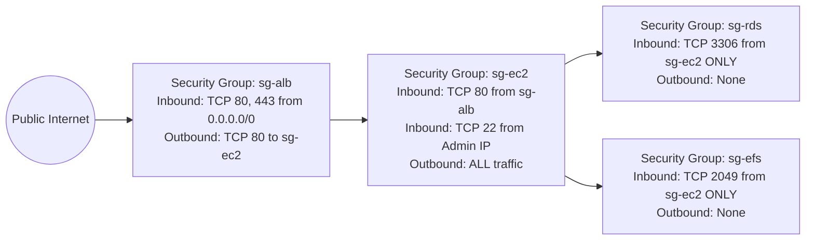

# CloudOps 360 — AWS Cloud Architecture

**CloudOps 360: Secure IT Service & Incident Management Platform** is engineered following the **AWS Well-Architected Framework**, balancing Security, Reliability, Performance Efficiency, and Cost Optimization for enterprise operations.

---

## 1. End-to-End AWS Architecture Diagram

```mermaid
flowchart TB
    subgraph Users ["Enterprise Actors"]
        Emp["Employee (Browser)"]
        Tech["Technician (Browser)"]
        Admin["Administrator (Browser)"]
    end

    subgraph AWSCloud ["Amazon Web Services (AWS) Cloud — Region: us-east-1"]
        subgraph EdgeLayer ["Edge & DNS Layer"]
            Route53["Amazon Route 53 (DNS)"]
            ACM["AWS Certificate Manager (TLS/SSL)"]
            ALB["Application Load Balancer (HTTPS:443 / Target Group)"]
        end

        subgraph VPC ["Amazon Virtual Private Cloud (10.0.0.0/16)"]
            subgraph PublicSubnets ["Public Subnets (us-east-1a, us-east-1b)"]
                NATGW["NAT Gateway"]
                IGW["Internet Gateway"]
                ALB_Node["ALB Public Endpoints"]
            end

            subgraph AppTierSubnets ["Application Tier — Private Subnets"]
                subgraph ASG ["Auto Scaling Group (EC2 Linux Instances)"]
                    EC2_1["EC2 Instance 1\n(Nginx + Gunicorn + Flask)\nIAM: CloudOps360-EC2-Role"]
                    EC2_2["EC2 Instance 2\n(Nginx + Gunicorn + Flask)\nIAM: CloudOps360-EC2-Role"]
                end
            end

            subgraph DataTierSubnets ["Data & Storage Tier — Isolated Private Subnets"]
                RDS["Amazon RDS for MySQL 8.0\n(Multi-AZ Active/Standby)\nEncrypted with AWS KMS"]
                EFS["Amazon EFS Shared File System\n(General Purpose / POSIX Mounts)\nEncrypted with AWS KMS\nMount: /mnt/efs/cloudops360-attachments"]
            end
        end

        subgraph SecurityAndMgmt ["Security & Governance Services"]
            SecretsMgr["AWS Secrets Manager\n(DB Credentials & Flask Secret)"]
            CloudWatch["Amazon CloudWatch\n(Logs, Alarms & Metrics)"]
            IAM["AWS Identity & Access Management (IAM)\n(Least-Privilege Instance Roles)"]
        end
    end

    %% Network Connections
    Emp -->|HTTPS 443| Route53
    Tech -->|HTTPS 443| Route53
    Admin -->|HTTPS 443| Route53
    Route53 --> ALB
    ACM -.->|TLS Termination| ALB
    ALB -->|HTTP 80 / Reverse Proxy| EC2_1
    ALB -->|HTTP 80 / Reverse Proxy| EC2_2

    %% Storage Connections
    EC2_1 -->|MySQL Protocol: TCP 3306| RDS
    EC2_2 -->|MySQL Protocol: TCP 3306| RDS
    EC2_1 -->|NFSv4.1 Protocol: TCP 2049 (TLS)| EFS
    EC2_2 -->|NFSv4.1 Protocol: TCP 2049 (TLS)| EFS

    %% Management Connections
    EC2_1 -.->|IAM Role Assume| SecretsMgr
    EC2_2 -.->|IAM Role Assume| SecretsMgr
    EC2_1 -.->|Forward Logs & Metrics| CloudWatch
    EC2_2 -.->|Forward Logs & Metrics| CloudWatch
    IAM -.->|Assigned to| ASG
```

---

## 2. Infrastructure Component Specifications

| Layer | AWS Service | Configuration Details | Purpose |
| :--- | :--- | :--- | :--- |
| **Compute** | Amazon EC2 (Linux) | Amazon Linux 2023 / Ubuntu 22.04, `t3.micro` or `t3.small` (Free-tier eligible) | Hosts Nginx reverse proxy, Gunicorn WSGI, and Flask application factory. |
| **Application Server** | Gunicorn | 3 Sync Workers, bound to Unix socket `/run/cloudops360/cloudops360.sock` | High-throughput, concurrent Python request execution. |
| **Web Server** | Nginx | HTTP reverse proxy, HTTPS termination, static asset caching, Gzip compression | Directs client requests to Gunicorn, handles TLS certificates, serves static files. |
| **Relational Database** | Amazon RDS for MySQL | MySQL 8.0 engine, `db.t3.micro`, Storage: 20GB gp3 with auto-scaling | Manages users, tickets, comments, attachment metadata, audit logs, SLA policies. |
| **Shared File Storage** | Amazon EFS | General Purpose mode, Bursting throughput, KMS encryption at rest | Mounts at `/mnt/efs/cloudops360-attachments` to store screenshots, logs, diagnostic zips. |
| **Secrets & Keys** | AWS Secrets Manager | JSON secret `cloudops360/production/db-secret` with auto-rotation | Eliminates permanent hardcoded database credentials from source code and `.env`. |
| **Access Control** | AWS IAM | Instance Profile `CloudOps360-EC2-Role` with least-privilege policy | Authorizes EC2 instances to retrieve Secrets Manager keys and mount EFS without access keys. |
| **Monitoring** | Amazon CloudWatch | System metrics, application error alarms, access logs | Real-time observability of EC2 CPU, RDS replication latency, and audit logs. |

---

## 3. Security Group Firewall Topology



### Security Group Inbound/Outbound Rules

1. **`sg-alb` (Application Load Balancer SG)**:
   - Inbound: `TCP 80` (HTTP) from `0.0.0.0/0`
   - Inbound: `TCP 443` (HTTPS) from `0.0.0.0/0`
   - Outbound: `TCP 80` targeting `sg-ec2`
2. **`sg-ec2` (Application Instances SG)**:
   - Inbound: `TCP 80` from `sg-alb`
   - Inbound: `TCP 22` (SSH) restricted to authorized administrator CIDR block (e.g. `203.0.113.50/32`)
   - Outbound: `TCP 3306` to `sg-rds`, `TCP 2049` to `sg-efs`, `HTTPS 443` to AWS API endpoints.
3. **`sg-rds` (Database SG — Strictly Private)**:
   - Inbound: `TCP 3306` (MySQL) restricted to source security group `sg-ec2`. **Never exposed to `0.0.0.0/0`.**
   - Outbound: None.
4. **`sg-efs` (Shared Storage SG — Strictly Private)**:
   - Inbound: `TCP 2049` (NFS) restricted to source security group `sg-ec2`. **Never exposed publicly.**
   - Outbound: None.

---

## 4. Multi-Instance High Availability & EFS Shared Consistency

When multiple EC2 instances are launched behind the ALB:
1. **Stateless Compute**: Flask stores sessions in cryptographically signed, encrypted client cookies (`SESSION_COOKIE_HTTPONLY=True`, `SESSION_COOKIE_SAMESITE='Lax'`). Any instance can serve any user request without requiring sticky sessions.
2. **Centralized Relational State**: All relational data (tickets, status transitions, comments, audit logs) reside centrally in Amazon RDS.
3. **Unified Diagnostic File Store**: When an employee uploads an incident attachment on `EC2 Instance 1`, the file is written to `/mnt/efs/cloudops360-attachments/<uuid>.<ext>` on Amazon EFS. Because `EC2 Instance 2` mounts the identical EFS filesystem, a technician whose request is routed to `EC2 Instance 2` immediately downloads and inspects the identical file without replication delay or synchronization scripts.
