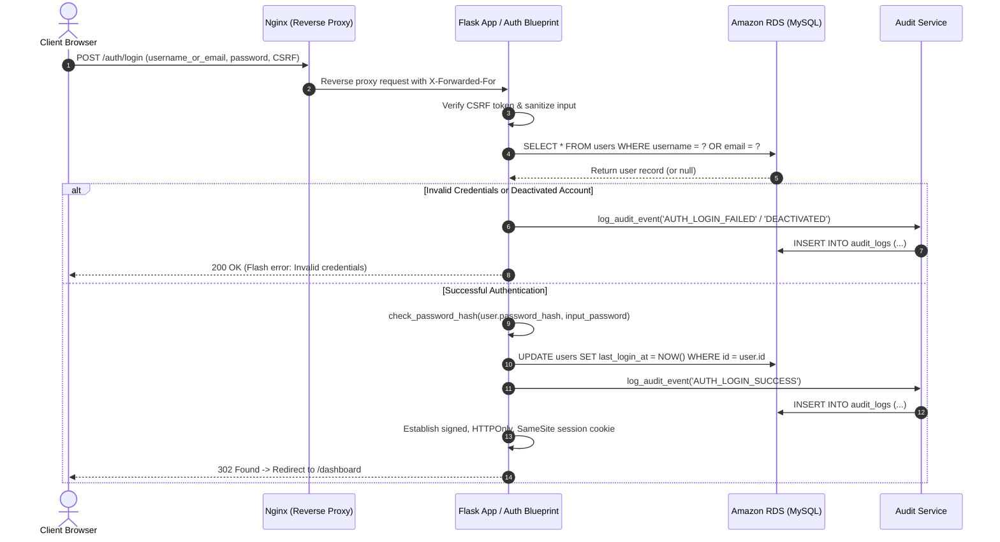
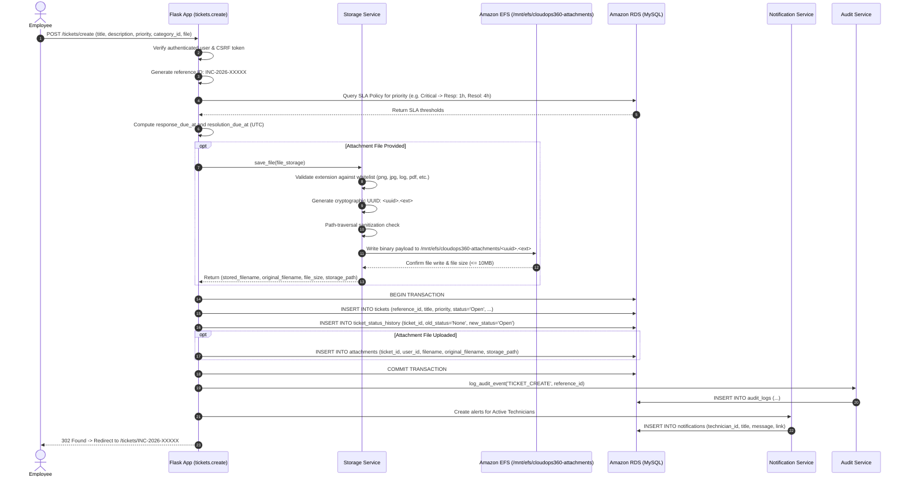
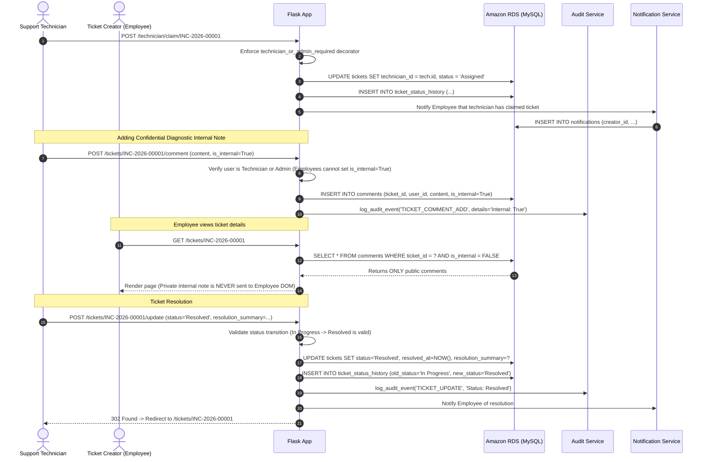
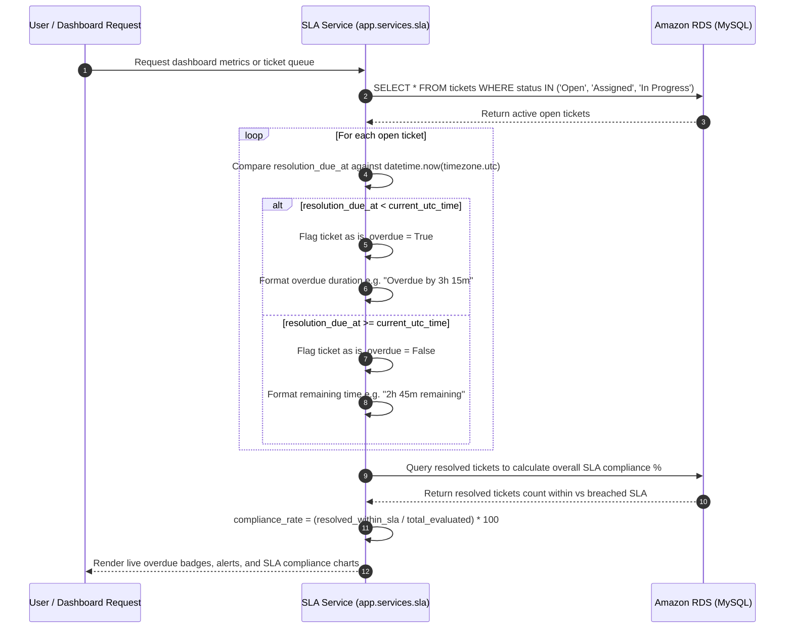

# CloudOps 360 — Request & Data-Flow Documentation

This document diagrams the complete lifecycle of requests, data boundaries, and security validation checks across **CloudOps 360**.

---

## 1. Authentication & Role-Based Access Control (RBAC) Flow

---

## 2. Incident Ticket Creation & Amazon EFS Storage Flow

---

## 3. Support Technician Review, Private Internal Notes & Resolution Flow

---

## 4. SLA Monitoring Engine & Overdue Detection Flow

