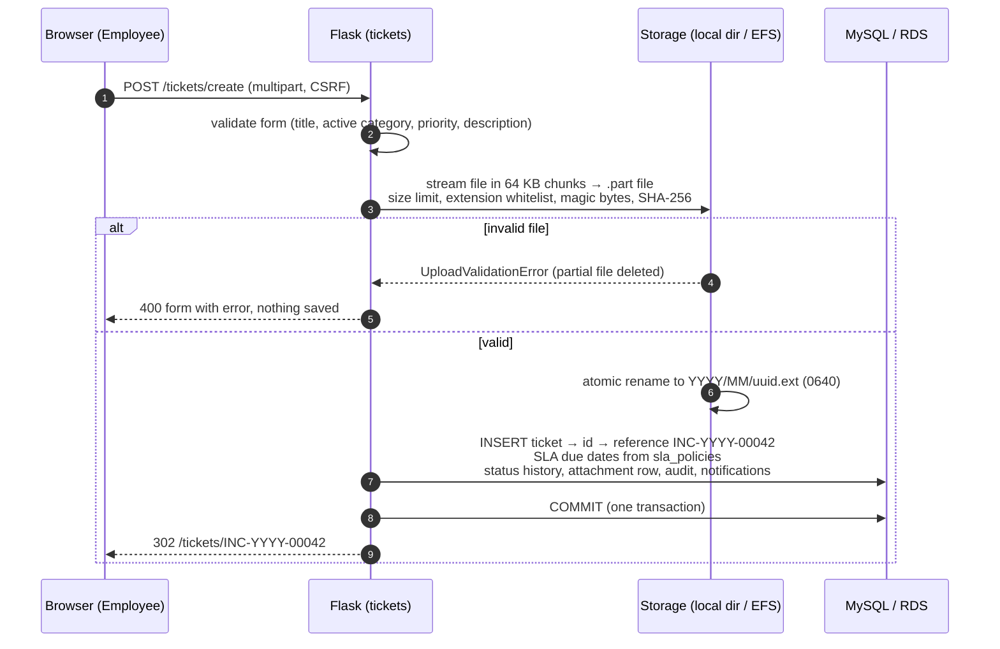
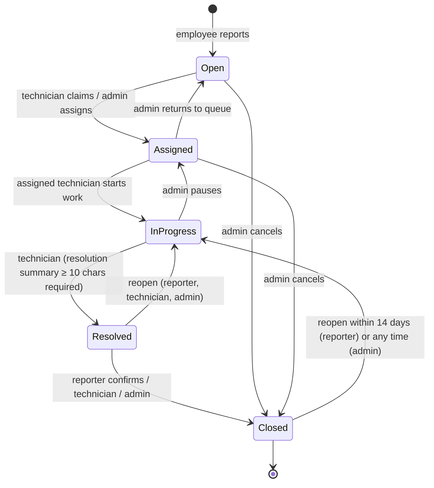
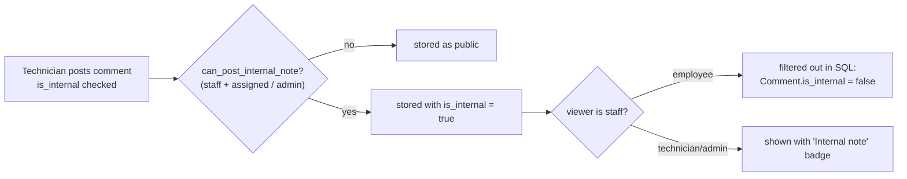
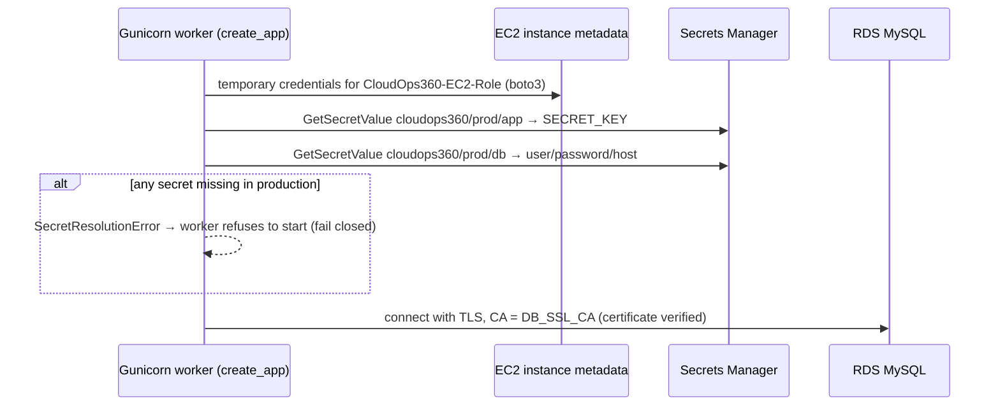

# CloudOps 360 — Request & Data Flows

Every flow below is implemented in the code referenced and covered by the tests named.

## 1. Sign-in, session and authorization

```mermaid
sequenceDiagram
    autonumber
    participant B as Browser
    participant N as Nginx
    participant F as Flask (auth)
    participant DB as MySQL / RDS
    B->>N: POST /auth/login (CSRF token, username, password)
    N->>F: proxy (X-Forwarded-For / Proto)
    F->>F: validate CSRF token (Flask-WTF)
    F->>DB: count recent failed login_attempts (account + IP)
    alt locked out
        F->>DB: audit AUTH_LOGIN_LOCKED
        F-->>B: 429 "Too many failed sign-in attempts"
    else
        F->>DB: SELECT user; check_password_hash()
        alt wrong password / unknown user
            F->>DB: insert login_attempt(success=false), audit AUTH_LOGIN_FAILED
            F-->>B: 401 generic error
        else deactivated
            F-->>B: 403
        else success
            F->>F: session.clear() (rotate), login_user, login_at/last_seen
            F->>DB: insert login_attempt(success=true), audit AUTH_LOGIN_SUCCESS
            F-->>B: 302 → role dashboard (HttpOnly, SameSite=Lax, Secure over HTTPS)
        end
    end
    Note over F: Every later request: account still active? idle < 30 min? absolute < 8 h?<br/>otherwise logout + audit AUTH_SESSION_EXPIRED / REVOKED
```

Code: `app/auth/routes.py`, `app/services/login_security.py`, `app/__init__.py` (`enforce_session_policy`).
Tests: `tests/test_auth.py`.

## 2. Creating an incident with an attachment



If the database commit fails after the file was stored, the file is deleted (no orphans).
Code: `app/tickets/routes.py::create`, `app/services/storage.py`. Tests: `tests/test_tickets.py`, `tests/test_attachments.py`.

## 3. Authorized download

```mermaid
sequenceDiagram
    participant B as Browser
    participant F as Flask (attachments)
    participant DB as MySQL / RDS
    participant S as Storage (EFS)
    B->>F: GET /attachments/7/download
    F->>DB: load attachment + ticket
    F->>F: can_view_ticket(user, ticket)?<br/>creator / assigned technician / admin
    alt not allowed
        F->>DB: audit ATTACHMENT_UNAUTHORIZED_DOWNLOAD
        F-->>B: 403
    else allowed
        F->>S: resolve key inside storage root (no traversal)
        F->>DB: audit ATTACHMENT_DOWNLOAD
        F-->>B: 200 Content-Disposition: attachment; X-Content-Type-Options: nosniff;<br/>CSP: sandbox; Cache-Control: private, no-store
    end
```

## 4. Ticket lifecycle and notifications



Every accepted transition writes `ticket_status_history`, an audit entry
(`TICKET_STATUS_CHANGE` / `TICKET_REOPEN`) and notifications to the other parties; rejected ones are
audited as `TICKET_TRANSITION_REJECTED`. Reopening restarts the resolution SLA window. Changing
priority recalculates SLA targets. Code: `app/services/workflow.py`. Tests: `tests/test_workflow.py`.

## 5. Internal notes



Employees never receive internal notes in HTML, notifications or the activity timeline.
Tests: `tests/test_internal_notes.py`.

## 6. SLA evaluation

* On create: `response_due_at = created + policy.response_hours`, `resolution_due_at = created + policy.resolution_hours`.
* First public staff reply or move to *In Progress* sets `first_responded_at`.
* Overdue = active status and `now > resolution_due_at` (SQL filter for lists; property for display).
* Compliance = resolved on time ÷ (all resolved + active overdue). Shown as "—" when nothing is evaluated yet.
* Code: `app/services/sla.py`, `app/services/metrics.py`. Tests: `tests/test_sla.py`, `tests/test_dashboards.py`.

## 7. Production secret resolution (EC2)



Code: `app/services/secrets.py`. Tests: `tests/test_security.py` (fail-closed cases).
