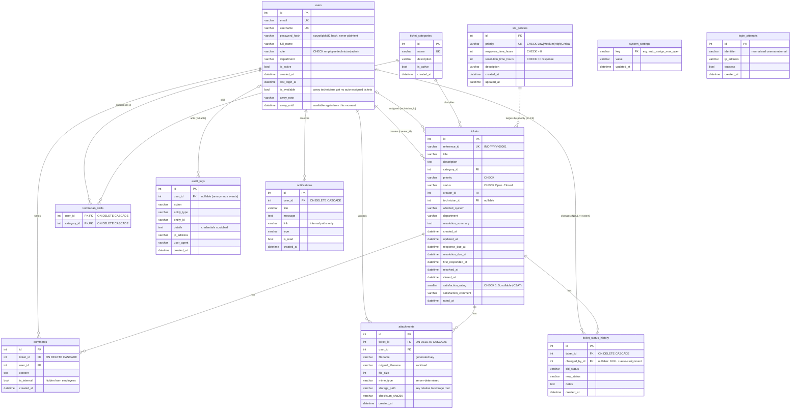

# CloudOps 360 — Database Design (ER)

Engine: **MySQL 8.0** locally and **Amazon RDS for MySQL** in production (`utf8mb4`).
Schema is created only through **Alembic migrations** (`flask db upgrade`); models live in
`app/models.py`. All timestamps are stored as UTC `DATETIME`.

Verified locally on MySQL 8.0.43: `flask db upgrade` → `downgrade` → `upgrade`, `flask db check`
(models match migrations) and the CHECK constraints rejecting invalid values (MySQL error 3819).

## 1. Entity-relationship diagram

`login_attempts` has no foreign key on purpose: it must also record attempts for usernames that
do not exist, without revealing which accounts exist.

## 2. Constraints

| Kind | Where |
| :--- | :--- |
| Primary keys | every table (`id`) |
| Unique | `users.email`, `users.username`, `ticket_categories.name`, `sla_policies.priority`, `tickets.reference_id` |
| Foreign keys | tickets → users (creator, technician), tickets → ticket_categories; comments/attachments/status history → tickets (cascade) and → users; notifications → users (cascade); audit_logs → users |
| CHECK | `ck_users_role`, `ck_tickets_status`, `ck_tickets_priority`, `ck_sla_policies_priority`, `ck_sla_policies_response_positive`, `ck_sla_policies_resolution_gte_response` |
| NOT NULL | all identifying and workflow columns |

Application-level rules (workflow transitions, who may do what) are enforced in
`app/services/workflow.py` and `app/services/permissions.py`; the database constraints are a
second line of defence against invalid values.

## 3. Indexes

| Index | Serves |
| :--- | :--- |
| `tickets(reference_id)` unique | ticket URLs |
| `tickets(creator_id, status)` | employee dashboards and "My tickets" |
| `tickets(technician_id, status)` | technician queue / workload |
| `tickets(status)`, `(priority)`, `(created_at)`, `(title)` | filters, sorting, trends |
| `notifications(user_id, is_read)` | unread badge polling |
| `audit_logs(action)`, `(created_at)`, `(user_id)` | audit filters |
| `login_attempts(identifier, created_at)`, `(ip_address, created_at)` | rate-limit lookups |

## 4. Migrations

| Revision | Content |
| :--- | :--- |
| `808b3a0090e9` | initial schema (9 tables) |
| `824a33157b1b` | `login_attempts`, `attachments.checksum_sha256`, relative storage keys, CHECK constraints, composite indexes |

Commands: `flask db upgrade` (apply), `flask db downgrade` (revert one), `flask db migrate -m "msg"`
(generate after model changes — review the file, then commit it), `flask db check` (verify models
and migrations agree).

## 5. Transactions

Each user action is committed once: the ticket change, its status-history row, audit entry and
notifications are staged on the same session and committed together (`commit=False` in
`log_audit_event` / `create_notification`). Failed uploads roll back the transaction and delete
any file already written.
