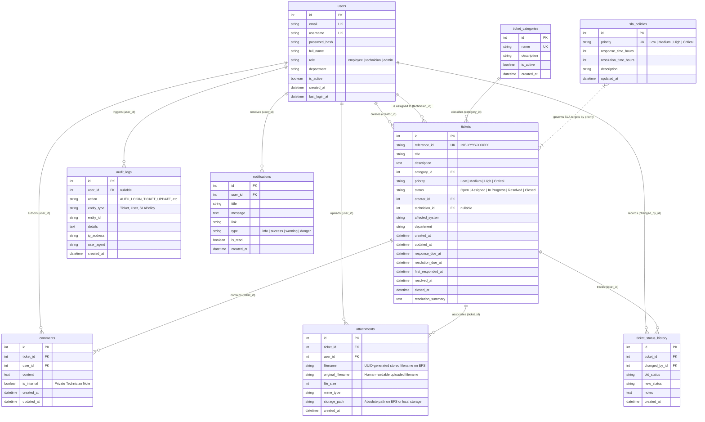

# CloudOps 360 — Database Entity-Relationship (ER) Documentation

This document describes the relational database schema implemented in **MySQL 8.0 / Amazon RDS for MySQL**, managed via **Flask-SQLAlchemy** and version-controlled using **Flask-Migrate**.

---

## 1. Database Entity-Relationship Diagram

---

## 2. Table Specifications & Column Dictionary

### 2.1 `users`
Stores user identities, hashed credentials, and role authorizations.
- `id` (INT, PK, Auto Increment)
- `email` (VARCHAR(120), Unique, Not Null, Indexed): Enterprise email address.
- `username` (VARCHAR(64), Unique, Not Null, Indexed): Unique account username.
- `password_hash` (VARCHAR(255), Not Null): Cryptographic hash generated using `werkzeug.security.generate_password_hash` (Scrypt / PBKDF2). Plaintext passwords are never stored.
- `full_name` (VARCHAR(100), Not Null): Human-readable user name.
- `role` (VARCHAR(20), Not Null, Indexed, Default: `'employee'`): Role enum: `'employee'`, `'technician'`, `'admin'`.
- `department` (VARCHAR(100), Nullable): Functional organizational unit.
- `is_active` (BOOLEAN, Default: `True`): Administrative account activation flag.
- `created_at` (DATETIME, Default: UTC Now).
- `last_login_at` (DATETIME, Nullable): Timestamp of most recent successful authentication.

### 2.2 `ticket_categories`
Incident classification catalog.
- `id` (INT, PK, Auto Increment)
- `name` (VARCHAR(64), Unique, Not Null): E.g., `Cloud Infrastructure`, `Identity & Access`, `Network & Connectivity`.
- `description` (VARCHAR(255), Nullable): Category scope guidelines.
- `is_active` (BOOLEAN, Default: `True`).
- `created_at` (DATETIME, Default: UTC Now).

### 2.3 `sla_policies`
Configurable Service Level Agreement targets by incident priority.
- `id` (INT, PK, Auto Increment)
- `priority` (VARCHAR(20), Unique, Not Null): Priority level (`'Critical'`, `'High'`, `'Medium'`, `'Low'`).
- `response_time_hours` (INT, Not Null): Maximum permitted hours to first technician response.
- `resolution_time_hours` (INT, Not Null): Maximum permitted hours to incident resolution.
- `description` (VARCHAR(255), Nullable).
- `updated_at` (DATETIME, Default: UTC Now).

### 2.4 `tickets`
Central incident repository tracking technical lifecycle and SLA deadlines.
- `id` (INT, PK, Auto Increment)
- `reference_id` (VARCHAR(32), Unique, Not Null, Indexed): Standardized reference, e.g. `INC-2026-00001`.
- `title` (VARCHAR(200), Not Null, Indexed): Concise issue summary.
- `description` (TEXT, Not Null): Diagnostic details and symptoms.
- `category_id` (INT, FK -> `ticket_categories.id`, Not Null).
- `priority` (VARCHAR(20), Not Null, Indexed, Default: `'Medium'`): `'Critical'`, `'High'`, `'Medium'`, `'Low'`.
- `status` (VARCHAR(20), Not Null, Indexed, Default: `'Open'`): `'Open'`, `'Assigned'`, `'In Progress'`, `'Resolved'`, `'Closed'`.
- `creator_id` (INT, FK -> `users.id`, Not Null, Indexed): Ticket author.
- `technician_id` (INT, FK -> `users.id`, Nullable, Indexed): Assigned support technician.
- `affected_system` (VARCHAR(100), Nullable): Affected resource name or ARN.
- `department` (VARCHAR(100), Nullable).
- `created_at` (DATETIME, Default: UTC Now, Indexed).
- `updated_at` (DATETIME, Default: UTC Now).
- `response_due_at` (DATETIME, Nullable): Calculated SLA response deadline.
- `resolution_due_at` (DATETIME, Nullable, Indexed): Calculated SLA resolution deadline.
- `first_responded_at` (DATETIME, Nullable): Timestamp of initial technician response/comment.
- `resolved_at` (DATETIME, Nullable): Timestamp when ticket status changed to `Resolved`.
- `closed_at` (DATETIME, Nullable): Timestamp when ticket status changed to `Closed`.
- `resolution_summary` (TEXT, Nullable): Root cause analysis and resolution steps.

### 2.5 `comments`
Chronological discussion stream supporting public comments and private internal technician notes.
- `id` (INT, PK, Auto Increment)
- `ticket_id` (INT, FK -> `tickets.id`, Not Null, Indexed).
- `user_id` (INT, FK -> `users.id`, Not Null, Indexed).
- `content` (TEXT, Not Null): Comment text.
- `is_internal` (BOOLEAN, Default: `False`, Not Null): When `True`, the note is strictly hidden from employee roles and visible only to technicians and admins.
- `created_at` (DATETIME, Default: UTC Now).
- `updated_at` (DATETIME, Default: UTC Now).

### 2.6 `attachments`
Metadata for diagnostic files, screenshots, and logs stored physically on Amazon EFS.
- `id` (INT, PK, Auto Increment)
- `ticket_id` (INT, FK -> `tickets.id`, Not Null, Indexed).
- `user_id` (INT, FK -> `users.id`, Not Null, Indexed): Uploader identity.
- `filename` (VARCHAR(255), Not Null): Cryptographically randomized UUID filename on EFS.
- `original_filename` (VARCHAR(255), Not Null): Original sanitized client filename.
- `file_size` (INT, Not Null): Size in bytes.
- `mime_type` (VARCHAR(100), Nullable): MIME classification.
- `storage_path` (VARCHAR(500), Not Null): Physical path on EFS mount or local storage directory.
- `created_at` (DATETIME, Default: UTC Now).

### 2.7 `ticket_status_history`
Immutable audit log of all ticket status changes and lifecycle transitions.
- `id` (INT, PK, Auto Increment)
- `ticket_id` (INT, FK -> `tickets.id`, Not Null, Indexed).
- `changed_by_id` (INT, FK -> `users.id`, Not Null).
- `old_status` (VARCHAR(20), Not Null).
- `new_status` (VARCHAR(20), Not Null).
- `notes` (TEXT, Nullable): Transition reasoning or summary.
- `created_at` (DATETIME, Default: UTC Now).

### 2.8 `audit_logs`
Security and administrative compliance audit trail.
- `id` (INT, PK, Auto Increment)
- `user_id` (INT, FK -> `users.id`, Nullable, Indexed): Actor identity, null for unauthenticated events.
- `action` (VARCHAR(64), Not Null, Indexed): Action code (e.g., `'AUTH_LOGIN_SUCCESS'`, `'TICKET_CLAIM'`).
- `entity_type` (VARCHAR(64), Nullable): Target object class (e.g. `'Ticket'`, `'User'`).
- `entity_id` (VARCHAR(64), Nullable): Target object ID or reference.
- `details` (TEXT, Nullable): Human-readable event description.
- `ip_address` (VARCHAR(45), Nullable): Client IPv4 or IPv6 (extracted from `X-Forwarded-For`).
- `user_agent` (VARCHAR(255), Nullable): Browser/client user-agent header.
- `created_at` (DATETIME, Default: UTC Now, Indexed).

### 2.9 `notifications`
Database-backed user alert queue with unread indicators.
- `id` (INT, PK, Auto Increment)
- `user_id` (INT, FK -> `users.id`, Not Null, Indexed): Recipient.
- `title` (VARCHAR(120), Not Null).
- `message` (TEXT, Not Null).
- `link` (VARCHAR(255), Nullable): In-app routing target URL.
- `type` (VARCHAR(20), Default: `'info'`): Visual badge style (`'info'`, `'success'`, `'warning'`, `'danger'`).
- `is_read` (BOOLEAN, Default: `False`, Indexed).
- `created_at` (DATETIME, Default: UTC Now, Indexed).

---

## 3. Database Indexes & Query Optimization Strategy

1. **Unique Indexes**:
   - `users.email` and `users.username` for O(1) authentication lookups.
   - `tickets.reference_id` for instant ticket resolution from URLs.
   - `ticket_categories.name` and `sla_policies.priority` to prevent duplicate catalog entries.
2. **Foreign Key Indexes**:
   - Explicit indexes on `ticket_id`, `user_id`, `category_id`, and `technician_id` to eliminate table scans during SQL joins.
3. **Filtering & Dashboard Indexes**:
   - `tickets.status` and `tickets.priority` to optimize dashboard counting queries.
   - `tickets.resolution_due_at` for high-speed overdue ticket identification (`WHERE status NOT IN ('Resolved', 'Closed') AND resolution_due_at < NOW()`).
   - `audit_logs.created_at` and `notifications.created_at` for reverse-chronological paginated streams.
